# Manual de usuario

**Sistema de Bitácora de Mantenimiento de Equipos** · Servicio de Salud Aysén

Este manual explica cómo usar el sistema en el trabajo diario: registrar equipos, planificar y
registrar el mantenimiento preventivo, anotar fallas, controlar convenios y obtener los reportes.
Está escrito para el equipo de mantención y la jefatura. No requiere conocimientos técnicos.

Las imágenes muestran el sistema con los datos del Hospital Regional Coyhaique.

---

## Contenido

1. [Ingreso al sistema](#1-ingreso-al-sistema)
2. [Cómo está organizada la pantalla](#2-cómo-está-organizada-la-pantalla)
3. [Perfiles: qué puede hacer cada usuario](#3-perfiles-qué-puede-hacer-cada-usuario)
4. [Escritorio](#4-escritorio)
5. [Equipos (catastro)](#5-equipos-catastro)
6. [Planificación del mantenimiento preventivo](#6-planificación-del-mantenimiento-preventivo)
7. [Bitácora: registrar las mantenciones](#7-bitácora-registrar-las-mantenciones)
8. [Mantenimiento correctivo](#8-mantenimiento-correctivo)
9. [Convenios y gasto](#9-convenios-y-gasto)
10. [Reportes e informes](#10-reportes-e-informes)
11. [Catálogos](#11-catálogos)
12. [Usuarios](#12-usuarios)
13. [Reglas que aplica el sistema](#13-reglas-que-aplica-el-sistema)
14. [Tareas frecuentes por perfil](#14-tareas-frecuentes-por-perfil)
15. [Preguntas frecuentes](#15-preguntas-frecuentes)

---

## 1. Ingreso al sistema

1. Abrir en el navegador la dirección del sistema que entregue el Subdepartamento de TI.
2. Escribir el **correo electrónico** y la **contraseña**, y presionar **Entrar**.
3. "Recordarme" mantiene la sesión abierta en ese computador; no lo use en equipos compartidos.

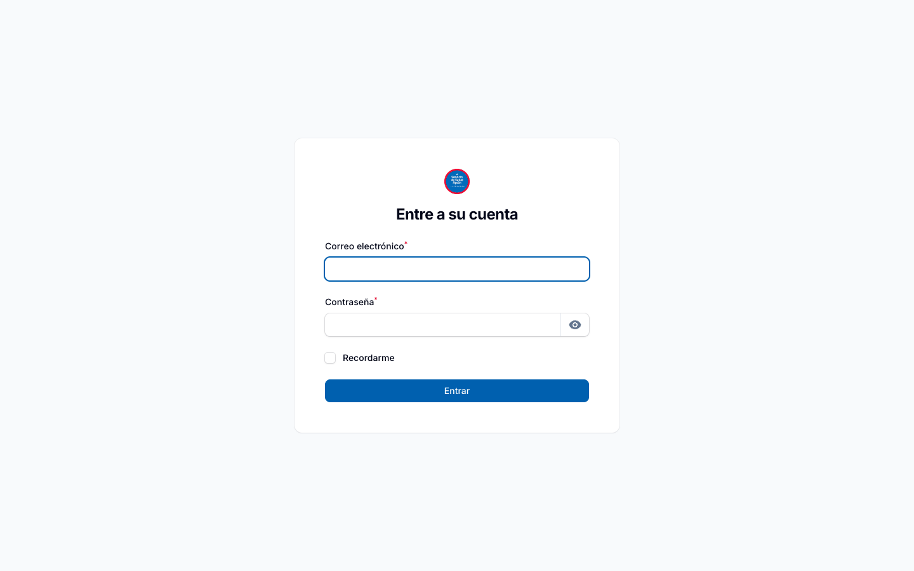

- El ícono del ojo en el campo contraseña permite ver lo que se escribió.
- Si la contraseña no funciona, o la cuenta está desactivada, solicite ayuda al administrador del
  sistema. No hay recuperación automática de contraseña.
- Para salir: clic en el círculo con sus iniciales (arriba a la derecha) → **Salir**.

---

## 2. Cómo está organizada la pantalla

- **Menú lateral (izquierda)**: las secciones del sistema, agrupadas en *Mantenimiento*,
  *Catálogos*, *Convenios y Gasto*, *Equipos* y *Administración*. La opción en uso se marca con una
  franja roja. Cada usuario ve solo las secciones de su perfil.
- **Barra superior**: el **buscador** (encuentra equipos por nombre, n° de inventario o n° de
  serie, y convenios por nombre), la **campana** de notificaciones y el menú de usuario.
- **Listados**: todas las secciones muestran sus registros en una tabla con:
  - **Buscar**: filtra por texto en las columnas principales.
  - **Filtros** (ícono del embudo): por recinto, servicio clínico, criticidad, estado, año, etc.
  - **Columnas** (ícono de las barras): muestra u oculta columnas. Las menos usadas vienen ocultas.
  - **Exportar a Excel**: descarga el listado **con los filtros aplicados**.
  - **Ver** (ojo) y **Editar** (lápiz) en cada fila.
- **Formularios**: los campos con asterisco (*) son obligatorios. Si falta un dato o es incorrecto,
  el sistema lo indica bajo el campo, por ejemplo "El campo Equipo es obligatorio.".

---

## 3. Perfiles: qué puede hacer cada usuario

| Perfil | Puede |
|---|---|
| **Encargado de Mantención** | Administrar catálogos, catastro de equipos, planificación, bitácora y mantenimiento correctivo; ver y descargar reportes. Ver convenios (sin modificarlos). |
| **Técnico Interno** | Registrar la bitácora y el mantenimiento correctivo de **los equipos que tiene asignados**. Ver el catastro y la planificación. |
| **Encargado de Convenios** | Administrar convenios, su ejecución mensual y los proveedores; ver reportes. |
| **Jefatura** | Ver todo el sistema y descargar reportes, sin modificar datos. |
| **Administrador** | Todo lo anterior, más usuarios y roles. |

**Recintos asignados**: además del perfil, cada usuario puede tener uno o más establecimientos
asignados. Si los tiene, solo ve y registra la información de esos establecimientos. Si no tiene
ninguno (personal del Subdepartamento), ve todos. Los convenios son comunes a todos los
establecimientos.

---

## 4. Escritorio

Es la pantalla inicial. Reúne lo que requiere atención y el avance del año.

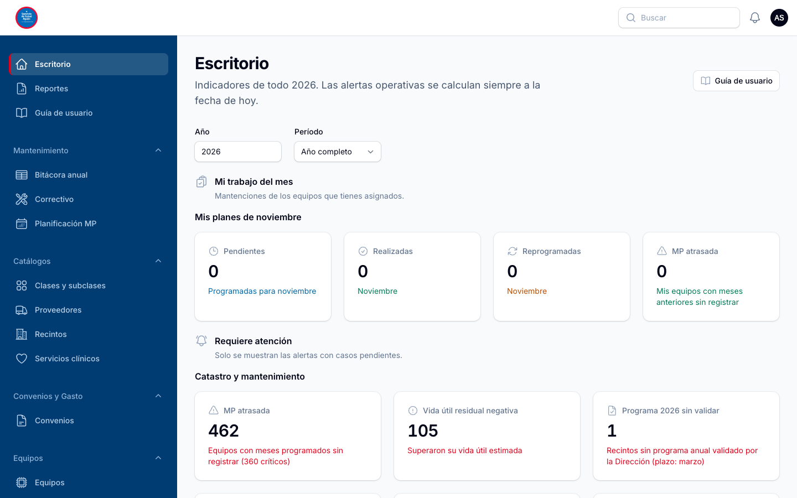

**Año y período**: arriba se elige el año y el período (año completo, semestre, trimestre o un mes).
Todos los indicadores y gráficos se recalculan con esa selección. El texto bajo el título indica qué
período se está viendo.

El Escritorio se organiza en secciones. Cada usuario ve las de su perfil:

- **Mi trabajo del mes** (técnico interno): sus mantenciones pendientes, realizadas y reprogramadas
  del mes, y sus equipos con mantenciones atrasadas.
- **Requiere atención**: solo aparecen las alertas con casos pendientes, primero las más urgentes
  (en rojo). Si no hay ninguna, se muestra "Todo al día". **Al hacer clic en una alerta se abre el
  listado con esos casos**. Las alertas son:
  - **MP atrasada**: equipos con meses programados que ya pasaron sin registrarse.
  - **Críticos sin plan**: equipos críticos sin plan de mantenimiento en el año.
  - **Críticos a retirar de uso**: equipos críticos con una mantención reprogramada que no se
    realizó dentro de 30 días.
  - **Programa sin validar**: desde abril, recintos sin programa anual validado por la Dirección.
  - **Equipos sin evaluar**, **garantía que vence** en el año y **vida útil residual negativa**.
  - **Convenios sobregirados** y **convenios por vencer** (próximos 60 días).
- **Mantenimiento preventivo**: el cumplimiento del período en cuatro cortes (total, equipos
  críticos, relevantes e IM ≥ 12), el gasto preventivo y correctivo frente a lo programado, y los
  gráficos mes a mes.
- **Catastro de equipos**: totales del catastro, correctivos del período y composición por estado
  y por criticidad.

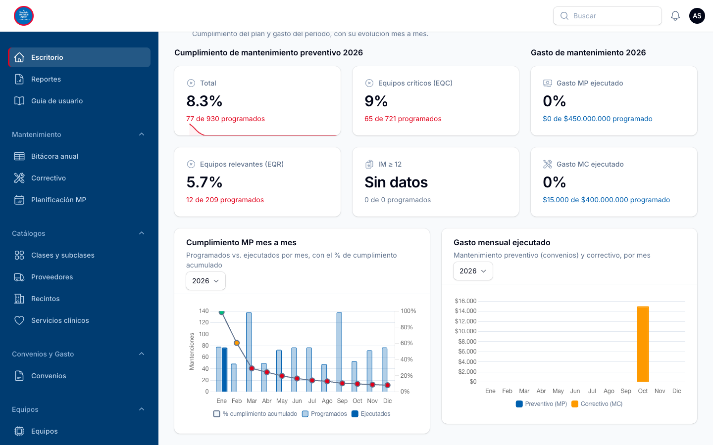

> **Cumplimiento** = mantenciones realizadas ÷ mantenciones programadas del período. Un mes
> reprogramado cuenta como programado y no realizado mientras no se marque como realizado.

---

## 5. Equipos (catastro)

Menú **Equipos → Equipos**. Es el registro de todos los equipos médicos.

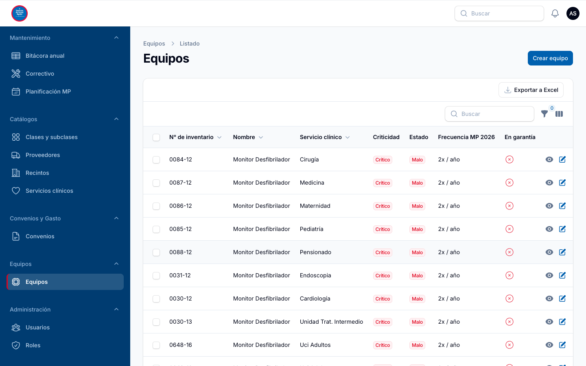

El listado muestra el n° de inventario, nombre, servicio clínico, criticidad, estado, frecuencia
de mantenimiento del año y garantía. Las demás columnas (recinto, clase, marca, modelo, serie,
etc.) se activan con el ícono de columnas, y la búsqueda las considera aunque estén ocultas.

### Crear o editar un equipo

**Crear equipo** (o **Editar** en un equipo existente). El formulario se ordena en secciones:

| Sección | Datos |
|---|---|
| Identificación | Nombre, marca, modelo, n° de serie, n° de inventario |
| Ubicación y clasificación | Recinto, servicio clínico, clase y subclase |
| Ficha técnica | Año de adquisición, vida útil (años), propiedad |
| Estado y garantía | Estado, criticidad, tipo de equipo crítico de la norma MINSAL, garantía y año de vencimiento, activo |
| Plan de mantenimiento | Si está bajo plan de MP y año de ingreso al plan |

- La **vida útil residual** se calcula sola a partir del año de adquisición y la vida útil.
- Si se indica un **tipo de equipo crítico de la norma** (ventilador, desfibrilador, incubadora,
  anestesia, diálisis o monitorización hemodinámica invasiva), la criticidad debe ser **Crítico**.

### Ficha del equipo

Con **Ver** se abre la ficha completa: datos, cumplimiento del año, gasto correctivo del año y, más
abajo, sus **planes de mantenimiento**, su **mantenimiento correctivo** y sus **retiros de uso**.

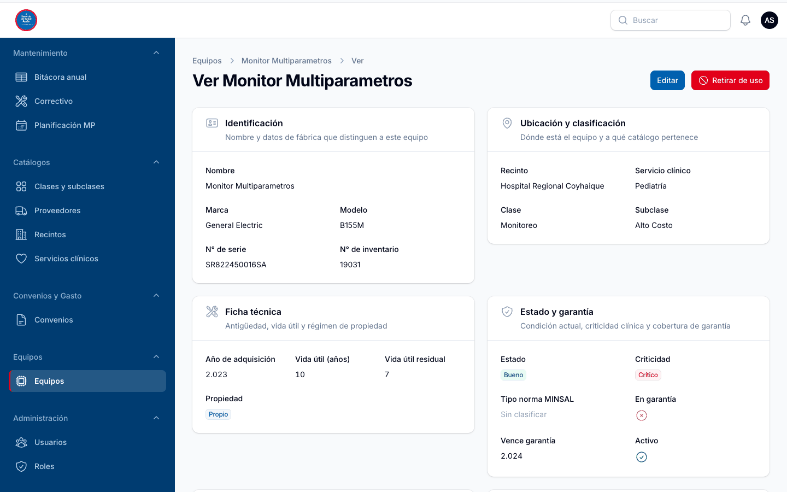

### Retirar un equipo de uso y registrar su reingreso

La norma exige retirar de uso un equipo crítico cuya mantención reprogramada no se realiza.

1. En la ficha del equipo, **Retirar de uso**.
2. Indicar **fecha de retiro**, **motivo** y **n° de documento de evidencia**.
3. Cuando vuelve a estar operativo: **Registrar reingreso**, con fecha y n° de documento.

El historial queda en la sección **Retiros de uso** de la ficha.

---

## 6. Planificación del mantenimiento preventivo

Menú **Mantenimiento → Planificación MP**. Cada equipo bajo plan tiene un plan por año.

### Crear un plan

1. **Crear plan de mantenimiento**.
2. Elegir el **equipo**, el **año** y la **frecuencia anual** (1, 2, 3, 4, 6 o 12 veces al año).
   Bajo la frecuencia aparece **"Meses que se programarán"**, con los meses que quedarán
   programados. Por ejemplo, con 2 veces al año: junio y diciembre.
3. En **Ejecución y costo**, el **tipo de mantenimiento**:
   - *Interno*: indicar el **responsable interno** (el técnico que registrará la bitácora).
   - *Externo*: indicar el **proveedor**.
   - Opcionalmente, el **convenio asociado** y el **costo anual de referencia**.
4. **Crear**. El sistema genera solo los 12 meses del plan, con los meses programados marcados.

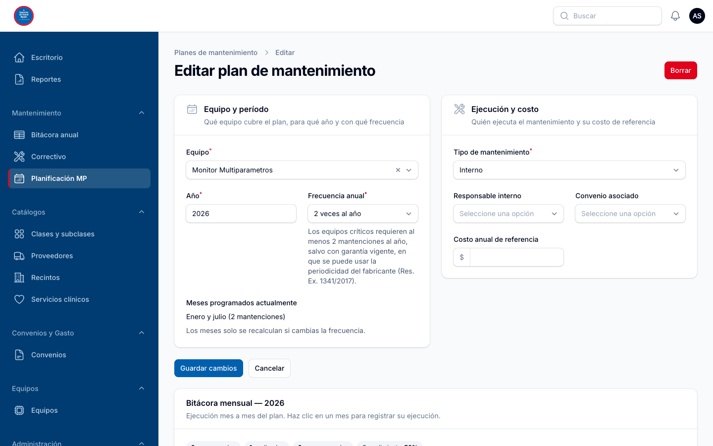

### Cambiar la frecuencia de un plan

Al editar un plan, el formulario muestra **"Meses programados actualmente"**. Si se cambia la
frecuencia, muestra **"Meses que se programarán al guardar"**. Los meses ya **realizados o
reprogramados se conservan**; solo se recalculan los demás.

> Los equipos **críticos** deben tener al menos **2 mantenciones al año**. La excepción son los
> equipos nuevos con garantía vigente, que pueden seguir la periodicidad del fabricante.

---

## 7. Bitácora: registrar las mantenciones

Hay dos formas de registrar, con las mismas reglas: desde el plan de cada equipo o desde la vista
anual de todos los equipos.

### Desde el plan del equipo

En **Planificación MP** → **Ver** o **Editar** un plan, la sección **Bitácora mensual** muestra los
12 meses:

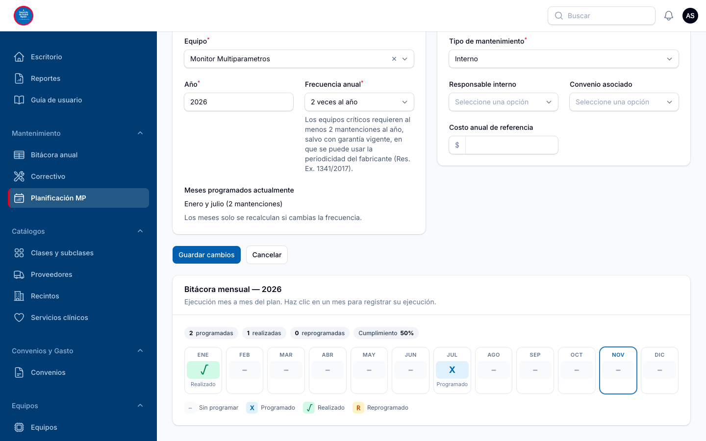

| Símbolo | Estado |
|---|---|
| – | Sin programar |
| **X** (azul) | Programado |
| **√** (verde) | Realizado (muestra la fecha) |
| **ꓣ** (ámbar) | Reprogramado |

Arriba se resumen las mantenciones programadas, realizadas y reprogramadas, y el cumplimiento del
plan. El mes en curso aparece con borde azul.

**Para registrar una mantención**: clic en el mes → se abre el formulario.

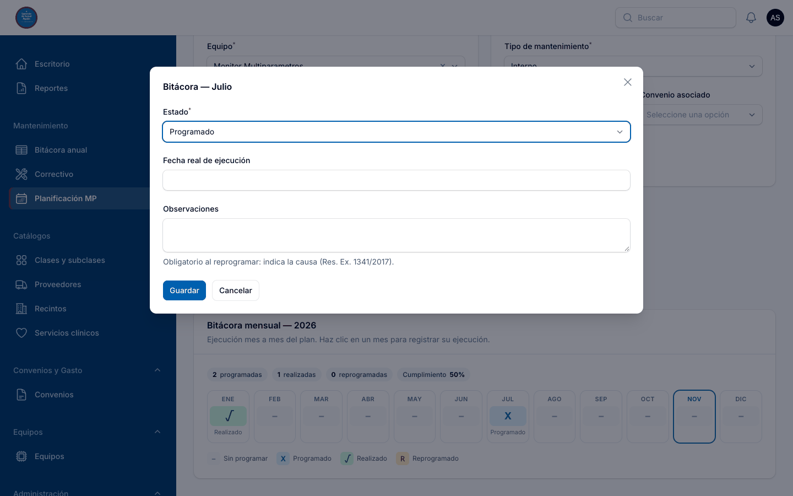

1. **Estado**: *Realizado* o *Reprogramado*.
2. **Fecha real de ejecución**: aparece al elegir *Realizado* y es obligatoria. No puede ser una
   fecha futura.
3. **Observaciones**: obligatorias al **reprogramar**; hay que indicar la causa.
4. Al reprogramar aparece además **N° de documento de justificación** (memo, oficio).
5. **Guardar**.

### Vista anual (todos los equipos)

Menú **Mantenimiento → Bitácora anual**. Muestra todos los planes del año en una tabla, como la
planilla: una fila por equipo y los 12 meses.

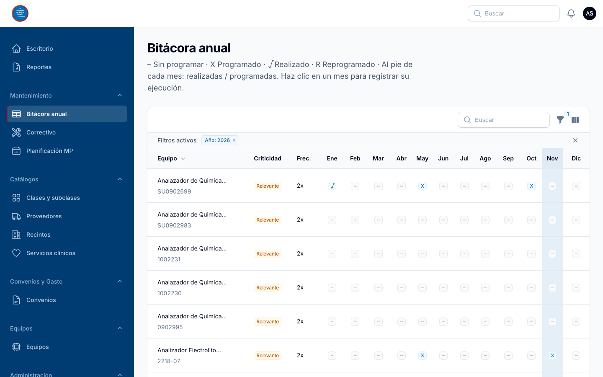

- Filtros por **año**, **recinto**, **servicio clínico** y **criticidad**, y búsqueda por nombre o
  n° de inventario.
- Al pie de cada mes: **realizadas / programadas** de los equipos filtrados.
- La columna del mes en curso aparece destacada.
- **Clic en un mes** para registrar, igual que desde el plan.

El técnico interno ve todos los equipos, pero solo puede registrar en los que tiene asignados. La
Jefatura ve la tabla en modo de solo lectura.

---

## 8. Mantenimiento correctivo

Menú **Mantenimiento → Correctivo**. Registra las fallas y reparaciones fuera del plan.

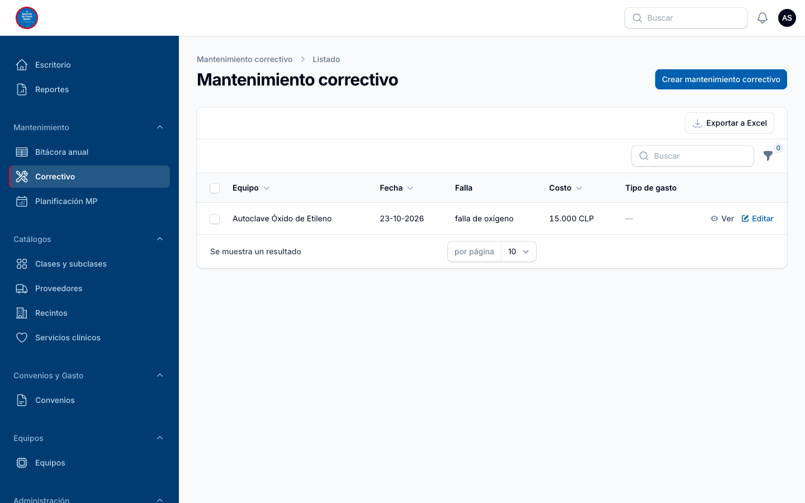

1. **Crear mantenimiento correctivo**.
2. **Equipo**, **fecha de la falla**, **descripción de la falla**, **costo** y **tipo de gasto**.
3. **Crear**.

El costo se suma automáticamente al gasto correctivo del período (Escritorio y Reportes). El
historial de fallas de un equipo también se ve en su ficha.

---

## 9. Convenios y gasto

Menú **Convenios y Gasto → Convenios**.

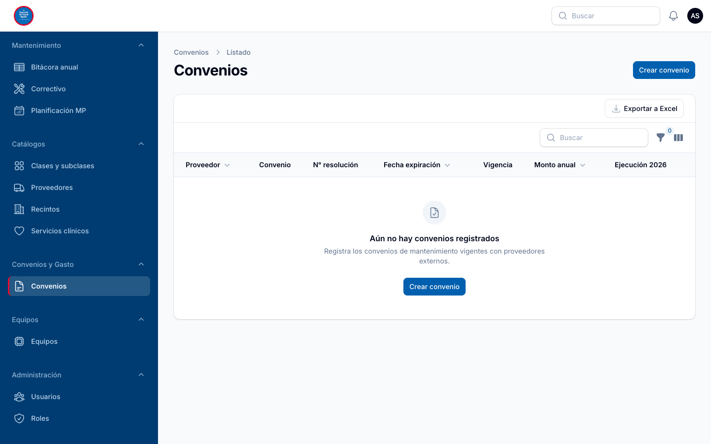

### Registrar un convenio

**Crear convenio**: **proveedor**, **nombre del convenio**, **n° de resolución / orden de compra**,
**fecha de resolución**, **fecha de expiración**, **monto anual**, **subasignación SIGFE** y
**activo**.

El listado muestra la **vigencia** de cada convenio (*Vigente*, *Vence en N días* cuando faltan 60
días o menos, *Vencido*) y el **% de ejecución** del año, en rojo si supera el monto anual.

### Registrar la ejecución mensual

En la ficha del convenio (**Ver**), sección **Ejecución mensual del gasto** → **Crear**: **año**,
**mes**, **n° orden de compra / factura** y **monto**.

Si la suma del año supera el monto anual, el sistema **avisa pero no impide el registro**, y deja
la alerta en la campana de notificaciones.

---

## 10. Reportes e informes

Menú **Reportes**.

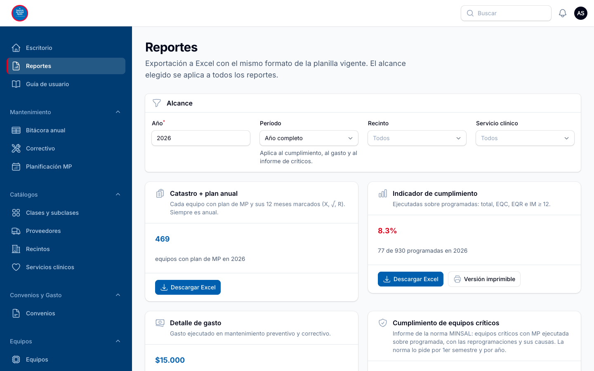

1. Elegir el **alcance** arriba: **año**, **período** (año, semestre, trimestre o mes),
   **recinto** y **servicio clínico**. Aplica a todos los reportes.
2. Cada tarjeta muestra un resumen y el botón **Descargar Excel**:

| Reporte | Contenido |
|---|---|
| **Catastro + plan anual** | Cada equipo con plan y sus 12 meses (X, √, ꓣ), con el formato de la planilla vigente. Siempre es anual. |
| **Indicador de cumplimiento** | Realizadas ÷ programadas, por total, EQC, EQR e IM ≥ 12. Con **Versión imprimible** del informe de cumplimiento y gasto (informes trimestrales y anuales). |
| **Detalle de gasto** | Gasto preventivo y correctivo, ejecutado frente a programado. |
| **Cumplimiento de equipos críticos** | Informe de la norma MINSAL (Res. Ex. 1341/2017): indicador por equipos, detalle por equipo y reprogramaciones con su causa. Con **Versión imprimible**. |
| **Convenios y ejecución** | Monto anual, ejecución y detalle mensual por orden de compra. No se acota por recinto. |

**Versión imprimible**: se abre en otra pestaña con formato de informe, encabezado institucional y
espacios de firma. Para guardarla como PDF: **Imprimir** → destino **Guardar como PDF**.

---

## 11. Catálogos

Menú **Catálogos**: listas que usan los equipos y planes. Mantenerlas al día evita escribir el
mismo dato de distintas formas.

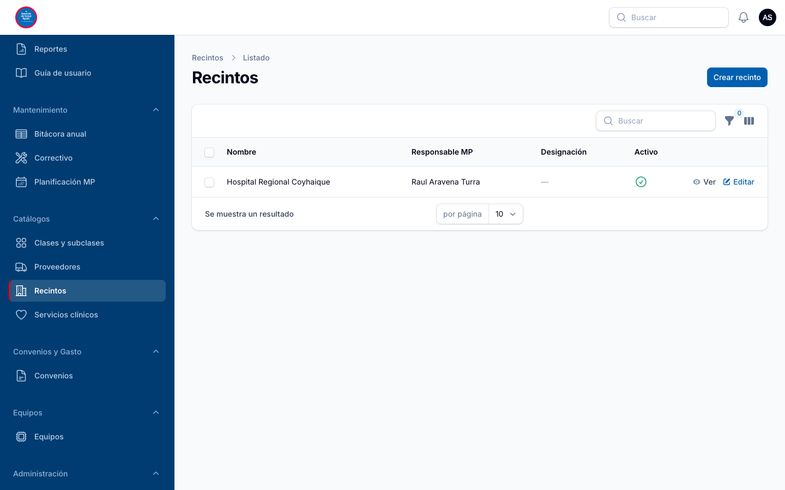

| Catálogo | Uso |
|---|---|
| **Recintos** | Establecimientos. En la ficha de cada recinto se registran además el **responsable de mantenimiento preventivo** designado, el **programa anual de MP** (fechas de definición y de validación por la Dirección) y el **gasto programado anual** de MP y MC. |
| **Servicios clínicos** | Lista normalizada de servicios. Muestra cuántos equipos tiene cada uno. |
| **Clases y subclases** | Clasificación de los equipos. |
| **Proveedores** | Empresas de mantenimiento externo y de convenios. |

Un valor que ya usa algún equipo **no se puede eliminar**: se debe **desactivar**. Así deja de
ofrecerse en los formularios sin perder la historia.

---

## 12. Usuarios

Menú **Administración → Usuarios** (solo administradores).

**Crear usuario**: **nombre**, **correo electrónico**, **contraseña**, **roles**, **recintos** (vacío
= todos) y **activo**.

- Para que un técnico pueda registrar la bitácora de un equipo, debe ser el **responsable interno**
  del plan de ese equipo (sección 6).
- Para que alguien deje de entrar al sistema, **desmarque "Activo"**. No es necesario eliminar la
  cuenta, y su historial se conserva.
- **Roles** (en el mismo grupo del menú) define qué pantallas ve cada perfil. Solo debe
  modificarlo el administrador del sistema.

---

## 13. Reglas que aplica el sistema

| Regla | Qué significa en la práctica |
|---|---|
| **Realizado con fecha** | Al marcar un mes como *Realizado* hay que indicar la fecha real de ejecución, que no puede ser futura. En los demás estados no se guarda fecha. |
| **Solo se registra lo programado** | Un mes se puede marcar *Realizado* o *Reprogramado* solo si estaba *Programado*. Si se intenta en un mes sin programar, el sistema lo rechaza con un mensaje. |
| **Reprogramar exige la causa** | Al reprogramar hay que escribir la causa en Observaciones. Se puede agregar el n° del documento de justificación. |
| **Plazo de 30 días** | Una mantención reprogramada de un equipo crítico debe realizarse dentro de 30 días desde el fin del mes programado. Si no, aparece la alerta "Críticos a retirar de uso". |
| **Mínimo 2 al año en críticos** | Un equipo crítico necesita al menos 2 mantenciones preventivas al año, salvo con garantía vigente (periodicidad del fabricante). |
| **Tipo de la norma ⇒ crítico** | Un equipo clasificado en uno de los tipos de equipo crítico de la norma debe tener criticidad Crítico. |
| **El plan se genera solo** | Al fijar la frecuencia se programan los meses. Cambiar la frecuencia no borra los meses ya realizados ni reprogramados. |
| **Correctivo suma al gasto** | Cada mantenimiento correctivo suma su costo al gasto del período. |
| **Sobregiro de convenio** | Superar el monto anual de un convenio genera alerta, pero no bloquea el registro. |
| **Catálogos protegidos** | Un valor en uso no se elimina; se desactiva. |

---

## 14. Tareas frecuentes por perfil

**Técnico Interno**
- Ver qué mantenciones me tocan este mes → *Escritorio → Mi trabajo del mes*.
- Registrar una mantención realizada → *Bitácora anual* (o el plan del equipo) → clic en el mes →
  *Realizado* + fecha → *Guardar*.
- Reprogramar → clic en el mes → *Reprogramado* + causa (+ n° de documento) → *Guardar*.
- Anotar una falla → *Correctivo → Crear mantenimiento correctivo*.

**Encargado de Mantención**
- Revisar lo pendiente → *Escritorio → Requiere atención* (clic en cada alerta).
- Dar de alta un equipo → *Equipos → Crear equipo*, y luego su plan en *Planificación MP*.
- Asignar un técnico a un equipo → editar el plan → *Responsable interno*.
- Retirar de uso un equipo crítico → ficha del equipo → *Retirar de uso*.
- Registrar el programa anual y su validación → *Recintos* → ficha del recinto → *Programa anual
  de MP*.
- Preparar el informe semestral o anual → *Reportes* → período → *Versión imprimible*.

**Encargado de Convenios**
- Registrar un convenio → *Convenios → Crear convenio*.
- Registrar la factura u orden de compra del mes → ficha del convenio → *Ejecución mensual del
  gasto → Crear*.
- Revisar sobregiros y vencimientos → *Escritorio → Requiere atención*, o la columna *Vigencia*
  del listado.

**Jefatura**
- Ver el avance → *Escritorio* (elegir año y período).
- Obtener informes → *Reportes* → *Descargar Excel* o *Versión imprimible*.

---

## 15. Preguntas frecuentes

**No puedo marcar un mes como realizado.**
Solo se registran los meses *Programados* (X). Si una mantención programada se hizo antes o
después, regístrela en el mes programado e indique la **fecha real de ejecución**. Si la
programación del plan no corresponde, el Encargado de Mantención puede ajustar la frecuencia del
plan.

**Como técnico, no puedo editar un equipo en la bitácora.**
Solo puede registrar en los equipos de los que es *responsable interno* en el plan. Pida al
Encargado de Mantención que lo asigne.

**El Escritorio muestra muchas mantenciones atrasadas.**
La alerta cuenta los meses programados ya pasados que no se han registrado. Se actualiza a medida
que se registra la bitácora.

**No encuentro un equipo de otro establecimiento.**
Si tiene recintos asignados, solo ve los suyos. Si necesita ver otros, pida al administrador que se
los asigne.

**¿Cómo guardo un informe en PDF?**
En *Reportes*, **Versión imprimible** → imprimir → destino **Guardar como PDF**.

**¿Puedo eliminar un servicio clínico mal escrito?**
Si ya lo usa algún equipo, no. Corrija el nombre editándolo, o desactívelo y use el correcto.

**Me equivoqué al registrar un mes.**
Vuelva a hacer clic en el mes y corrija el estado, la fecha o las observaciones. Todos los cambios
quedan registrados en la auditoría del sistema.

---

*Para consultas sobre el uso del sistema, contactar al Encargado de Mantención o al Subdepartamento
de Tecnologías de la Información del Servicio de Salud Aysén.*
