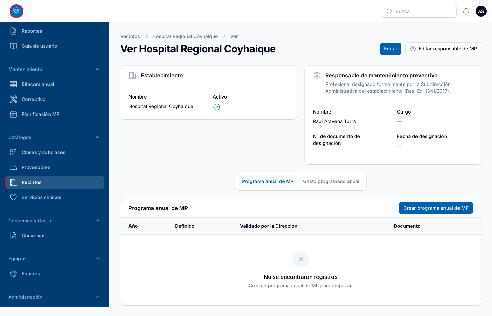

# Manual de usuario

**Sistema de Bitácora de Mantenimiento de Equipos** · Servicio de Salud Aysén

Este manual explica cómo usar el sistema en el trabajo diario: registrar equipos, planificar y
registrar el mantenimiento preventivo, anotar fallas, controlar convenios y obtener los reportes.
Está escrito para el equipo de mantención y la jefatura, y no requiere conocimientos técnicos.

Dentro del sistema, este manual se abre con el botón **Guía de usuario** del Escritorio, desde el
menú lateral o desde el menú de usuario (círculo con sus iniciales, arriba a la derecha).

Las imágenes muestran el sistema con los datos del Hospital Regional Coyhaique.

---

## Contenido

- [Cómo usar esta guía](#cómo-usar-esta-guía)
- [Ruta de capacitación por perfil](#ruta-de-capacitación-por-perfil)
1. [Ingreso al sistema](#1-ingreso-al-sistema)
2. [Cómo está organizada la pantalla](#2-cómo-está-organizada-la-pantalla)
3. [Perfiles: qué puede hacer cada usuario](#3-perfiles-qué-puede-hacer-cada-usuario)
4. [Escritorio](#4-escritorio)
5. [Equipos (catastro)](#5-equipos-catastro)
6. [Planificación del mantenimiento preventivo](#6-planificación-del-mantenimiento-preventivo)
7. [Bitácora: registrar las mantenciones](#7-bitácora-registrar-las-mantenciones)
8. [Mantenimiento correctivo](#8-mantenimiento-correctivo)
9. [Convenios y gasto](#9-convenios-y-gasto)
10. [Reportes e informes](#10-reportes-e-informes)
11. [Catálogos y ficha del recinto](#11-catálogos-y-ficha-del-recinto)
12. [Usuarios](#12-usuarios)
13. [Reglas que aplica el sistema](#13-reglas-que-aplica-el-sistema)
14. [Mensajes del sistema y qué hacer](#14-mensajes-del-sistema-y-qué-hacer)
15. [Preguntas frecuentes](#15-preguntas-frecuentes)
16. [Glosario](#16-glosario)

---

## Cómo usar esta guía

- **Si está aprendiendo**: siga la [ruta de capacitación de su perfil](#ruta-de-capacitación-por-perfil).
  Indica qué secciones leer, en qué orden, y trae ejercicios para practicar. Toma entre 30 y 60
  minutos.
- **Si busca cómo hacer algo puntual**: use el [Contenido](#contenido) o, en el navegador,
  **Ctrl + F** (en Mac, **Cmd + F**) para buscar una palabra.
- **Si el sistema muestra un mensaje que no entiende**: vea [Mensajes del sistema y qué
  hacer](#14-mensajes-del-sistema-y-qué-hacer).
- **Para tener la guía en papel o PDF**: botón **Imprimir o guardar como PDF**, arriba a la
  derecha de la guía.

En las instrucciones, el texto en **negrita** es el nombre exacto de un menú, botón o campo tal
como aparece en pantalla. Una flecha (→) separa los pasos: *Equipos → Crear equipo* significa
"abrir el menú Equipos y presionar el botón Crear equipo".

---

## Ruta de capacitación por perfil

Cada ruta indica las secciones que necesita su perfil y termina con una práctica. Haga las
prácticas en el sistema con un equipo real de su establecimiento: los registros quedan guardados,
así que use datos verdaderos o pida al Encargado de Mantención un equipo para practicar.

### Ruta: Técnico Interno

**Qué hace en el sistema**: registra en la bitácora las mantenciones preventivas de los equipos
que tiene asignados, y anota las fallas (mantenimiento correctivo).

**Lea, en este orden**:
1. [Ingreso al sistema](#1-ingreso-al-sistema) y [cómo está organizada la
   pantalla](#2-cómo-está-organizada-la-pantalla).
2. [Escritorio](#4-escritorio): la sección **Mi trabajo del mes**.
3. [Bitácora: registrar las mantenciones](#7-bitácora-registrar-las-mantenciones), completa.
4. [Mantenimiento correctivo](#8-mantenimiento-correctivo).
5. [Reglas que aplica el sistema](#13-reglas-que-aplica-el-sistema): las cuatro primeras.

**Práctica**:
- [ ] En el Escritorio, revise cuántas mantenciones tiene **Pendientes** este mes.
- [ ] En **Bitácora anual**, busque uno de sus equipos por su n° de inventario.
- [ ] Registre como **Realizado** un mes programado (X) de una mantención que ya hizo, con su
      fecha real.
- [ ] Abra de nuevo ese mes y compruebe que muestra **√** con la fecha.
- [ ] Registre una falla en **Correctivo → Crear mantenimiento correctivo** y búsquela luego en la
      ficha del equipo.

### Ruta: Encargado de Mantención

**Qué hace en el sistema**: mantiene el catastro de equipos y sus planes anuales, asigna los
técnicos, revisa las alertas, registra los datos de mantenimiento de su establecimiento y prepara
los informes.

**Lea, en este orden**:
1. Secciones [1](#1-ingreso-al-sistema), [2](#2-cómo-está-organizada-la-pantalla) y
   [3](#3-perfiles-qué-puede-hacer-cada-usuario).
2. [Escritorio](#4-escritorio), completa, con atención a **Requiere atención**.
3. [Equipos](#5-equipos-catastro) y [Planificación](#6-planificación-del-mantenimiento-preventivo).
4. [Bitácora](#7-bitácora-registrar-las-mantenciones) y [Correctivo](#8-mantenimiento-correctivo).
5. [Reportes e informes](#10-reportes-e-informes).
6. [Catálogos y ficha del recinto](#11-catálogos-y-ficha-del-recinto).
7. [Reglas que aplica el sistema](#13-reglas-que-aplica-el-sistema), completa.

**Práctica**:
- [ ] En el Escritorio, haga clic en una alerta de **Requiere atención** y revise el listado que
      se abre.
- [ ] Abra la ficha de un equipo crítico y revise su plan del año y su cumplimiento.
- [ ] Edite el plan de un equipo y asigne un **Responsable interno**.
- [ ] Cambie la frecuencia de un plan sin guardar y observe la vista previa de los meses.
- [ ] En la ficha de su recinto (**Catálogos → Recintos → Ver**), revise el responsable de MP,
      el programa anual y el gasto programado.
- [ ] En **Reportes**, elija el primer semestre y abra la **Versión imprimible** del informe de
      cumplimiento.

### Ruta: Encargado de Convenios

**Qué hace en el sistema**: registra los convenios de mantenimiento, su gasto mensual (órdenes de
compra o facturas) y los proveedores, y controla sobregiros y vencimientos.

**Lea, en este orden**:
1. Secciones [1](#1-ingreso-al-sistema) y [2](#2-cómo-está-organizada-la-pantalla).
2. [Escritorio](#4-escritorio): las secciones **Requiere atención** y **Convenios**.
3. [Convenios y gasto](#9-convenios-y-gasto), completa.
4. [Reportes e informes](#10-reportes-e-informes): el reporte **Convenios y ejecución**.
5. [Catálogos](#11-catálogos-y-ficha-del-recinto): **Proveedores**.

**Práctica**:
- [ ] En **Convenios**, revise la columna **Vigencia** y el **% de ejecución** de un convenio.
- [ ] Abra la ficha de un convenio (**Ver**) y registre una ejecución mensual con **Registrar
      ejecución mensual**.
- [ ] Compruebe que el registro aparece en la ficha y que cambió el **% de ejecución** del
      convenio en el listado.
- [ ] En **Reportes**, descargue el Excel de **Convenios y ejecución**.

### Ruta: Jefatura

**Qué hace en el sistema**: consulta el avance del mantenimiento, el gasto y los informes. Puede
ver todo, pero no modifica datos.

**Lea, en este orden**:
1. Secciones [1](#1-ingreso-al-sistema) y [2](#2-cómo-está-organizada-la-pantalla).
2. [Escritorio](#4-escritorio), completa.
3. [Reportes e informes](#10-reportes-e-informes), completa.
4. [Reglas que aplica el sistema](#13-reglas-que-aplica-el-sistema), para interpretar las alertas.

**Práctica**:
- [ ] En el Escritorio, cambie el **Período** a un trimestre y observe cómo cambian los
      indicadores.
- [ ] Haga clic en la alerta **MP atrasada** y revise qué equipos están atrasados.
- [ ] En **Reportes**, abra la **Versión imprimible** del informe de equipos críticos y guárdela
      como PDF.

### Ruta: Administrador

**Qué hace en el sistema**: todo lo anterior, más crear usuarios, asignarles perfil y
establecimientos, desactivar cuentas y revisar el registro de accesos.

**Lea**: la ruta del Encargado de Mantención y luego [Usuarios](#12-usuarios) y
[Perfiles](#3-perfiles-qué-puede-hacer-cada-usuario).

**Práctica**:
- [ ] Cree un usuario con el perfil **Técnico Interno** y un establecimiento asignado.
- [ ] Asígnelo como **Responsable interno** en el plan de un equipo.
- [ ] Desmarque **Activo** en su cuenta y compruebe que ya no puede ingresar.
- [ ] Abra **Registro de accesos** y encuentre el intento de ingreso de la cuenta desactivada.

---

## 1. Ingreso al sistema

1. Abra en el navegador la dirección del sistema que entregue el Subdepartamento de TI.
2. Escriba su **correo electrónico** y su **contraseña**, y presione **Entrar**.
3. **Recordarme** mantiene la sesión abierta en ese computador. No lo use en equipos compartidos.

- El ícono del ojo en el campo contraseña muestra lo que escribió.
- Si olvidó su contraseña, use **¿Ha olvidado su contraseña?** bajo el formulario (ver
  "Recuperar la contraseña", más abajo).
- Si la cuenta está desactivada, pida ayuda al administrador del sistema.
- **Bloqueo por intentos fallidos**: después de **5 intentos fallidos** con el mismo correo, el
  ingreso queda bloqueado por **15 minutos**, aunque luego escriba la contraseña correcta. También
  se bloquea por 15 minutos un computador o red desde donde se acumulan 20 intentos fallidos. El
  mensaje indica cuántos minutos faltan. Puede esperar o recuperar la contraseña, que también
  levanta el bloqueo de su cuenta.
- Para salir: clic en el círculo con sus iniciales (arriba a la derecha) → **Salir**.

### Recuperar la contraseña

1. En la pantalla de ingreso, presione **¿Ha olvidado su contraseña?**.
2. Escriba su correo electrónico y presione **Enviar email**.
3. Aparece el mensaje **Revise su correo**. Por seguridad, el mensaje es el mismo aunque el correo
   no esté registrado o la cuenta esté desactivada; en esos casos no llega ningún correo.
4. Abra el correo **Recuperación de contraseña** y presione **Crear contraseña nueva**. El enlace
   **vence en 60 minutos y sirve una sola vez**; si venció, pida uno nuevo.
5. Escriba la contraseña nueva dos veces (mínimo **12 caracteres**) y confirme. Luego ingrese con
   ella.

Si no recibió el correo, revise la carpeta de correo no deseado y espere un minuto antes de pedir
otro enlace. Si sigue sin llegar, avise al administrador del sistema.

---

## 2. Cómo está organizada la pantalla

- **Menú lateral (izquierda)**: las secciones del sistema. Arriba están **Escritorio**,
  **Reportes** y **Guía de usuario**, y debajo los grupos *Mantenimiento*, *Catálogos*,
  *Convenios y Gasto*, *Equipos* y *Administración*. La opción en uso se marca con una franja roja.
  Cada usuario ve solo las secciones de su perfil.
- **Barra superior**:
  - el **buscador**, que encuentra equipos por nombre, n° de inventario o n° de serie, y convenios
    por nombre;
  - la **campana** de notificaciones, por ejemplo cuando un convenio se sobregira;
  - el **menú de usuario** (círculo con sus iniciales), con la **Guía de usuario** y **Salir**.
- **Listados**: cada sección muestra sus registros en una tabla con:
  - **Buscar**: filtra por texto en las columnas principales.
  - **Filtros** (ícono del embudo): por recinto, servicio clínico, criticidad, estado, año, etc.
    Los filtros activos se muestran sobre la tabla y se quitan con la **x**.
  - **Columnas** (ícono de las barras): muestra u oculta columnas. Las menos usadas vienen ocultas.
  - **Exportar a Excel**: descarga el listado **con los filtros aplicados**.
  - **Ver** (ojo) y **Editar** (lápiz) en cada fila.
- **Formularios**: los campos con asterisco (\*) son obligatorios. Si falta un dato o es
  incorrecto, el sistema lo indica en rojo bajo el campo, por ejemplo "El campo equipo es
  obligatorio.", y no guarda hasta que se corrija.

---

## 3. Perfiles: qué puede hacer cada usuario

| Perfil | Puede |
|---|---|
| **Encargado de Mantención** | Administrar catastro de equipos, planificación, bitácora, mantenimiento correctivo y catálogos; registrar los datos de mantenimiento de su recinto; ver y descargar reportes. Ver convenios, sin modificarlos. |
| **Técnico Interno** | Registrar la bitácora y el mantenimiento correctivo de **los equipos que tiene asignados**. Ver el catastro y la planificación. |
| **Encargado de Convenios** | Administrar convenios, su ejecución mensual y los proveedores; ver reportes. |
| **Jefatura** | Ver todo el sistema y descargar reportes, sin modificar datos. |
| **Administrador** | Todo lo anterior, más usuarios y roles. |

**Recintos asignados**: además del perfil, cada usuario puede tener uno o más establecimientos
asignados. Si los tiene, solo ve y registra la información de esos establecimientos. Si no tiene
ninguno (personal del Subdepartamento), ve todos. Los convenios son comunes a todos los
establecimientos.

**Técnico asignado a un equipo**: un técnico registra la bitácora solo de los equipos en cuyo plan
figura como **Responsable interno** (sección 6).

---

## 4. Escritorio

Es la pantalla inicial. Reúne lo que requiere atención y el avance del año.

**Año y período**: arriba se elige el **Año** y el **Período** (año completo, semestre, trimestre
o un mes). Los indicadores y gráficos se recalculan con esa selección, y el texto bajo el título
indica qué período se está viendo. Las alertas operativas se calculan siempre a la fecha de hoy.

El botón **Guía de usuario**, arriba a la derecha, abre este manual.

El Escritorio se organiza en secciones. Cada usuario ve las de su perfil:

- **Mi trabajo del mes** (Técnico Interno): sus mantenciones **Pendientes**, **Realizadas** y
  **Reprogramadas** del mes, y sus equipos con **MP atrasada**.
- **Requiere atención**: solo aparecen las alertas con casos pendientes, primero las más urgentes
  (en rojo). Si no hay ninguna, se muestra **Todo al día**. **Al hacer clic en una alerta se abre
  el listado con esos casos.**
- **Mantenimiento preventivo**: el cumplimiento del período en cuatro cortes (total, equipos
  críticos, relevantes e IM ≥ 12), el gasto preventivo y correctivo frente a lo programado, y los
  gráficos mes a mes.
- **Catastro de equipos**: totales del catastro, correctivos del período y composición por estado
  y por criticidad.
- **Convenios** (Encargado de Convenios): convenios activos y su ejecución del año.

**Alertas de "Requiere atención"**

| Alerta | Qué indica | Qué hacer |
|---|---|---|
| **MP atrasada** | Equipos con meses programados que ya pasaron sin registrarse. | Registrar la bitácora de esos meses (sección 7). |
| **Críticos a retirar de uso** | Equipos críticos con una mantención reprogramada que no se realizó dentro de 30 días. | Realizar la mantención o retirar el equipo de uso (sección 5). |
| **Críticos sin plan *año*** | Equipos críticos sin plan de mantenimiento en el año. | Crear su plan (sección 6). |
| **Programa *año* sin validar** | Desde abril: recintos sin programa anual validado por la Dirección. | Registrar el programa en la ficha del recinto (sección 11). |
| **Planes con meses inconsistentes** | Planes cuyos meses programados no coinciden con la frecuencia, o que no tienen ningún mes programado. | Revisar el plan y corregir la frecuencia o los meses (sección 6). |
| **Equipos sin evaluar** | Equipos con estado "Sin evaluar". | Evaluar el equipo y actualizar su estado. |
| **Garantía vence este año** | Equipos cuya garantía vence en el año. | Prever su mantenimiento al terminar la garantía. |
| **Vida útil residual negativa** | Equipos que superaron su vida útil. | Evaluar su reposición. |
| **Convenios sobregirados** | Convenios cuyo gasto del año supera el monto anual. | Revisar la ejecución del convenio (sección 9). |
| **Convenios por vencer** | Convenios que expiran en los próximos 60 días. | Gestionar su renovación. |

> **Cumplimiento** = mantenciones realizadas ÷ mantenciones programadas del período. Un mes
> reprogramado cuenta como programado y no realizado mientras no se marque como realizado.

---

## 5. Equipos (catastro)

Menú **Equipos → Equipos**. Es el registro de todos los equipos médicos.

El listado muestra el n° de inventario, nombre, servicio clínico, criticidad, estado, frecuencia
de mantenimiento del año y garantía. Las demás columnas (recinto, clase, marca, modelo, serie,
etc.) se activan con el ícono de columnas, y la búsqueda las considera aunque estén ocultas.

### Crear o editar un equipo

**Crear equipo** (o **Editar** en un equipo existente). El formulario se ordena en secciones:

| Sección | Datos |
|---|---|
| Identificación | Nombre, marca, modelo, n° de serie, n° de inventario |
| Ubicación y clasificación | Recinto, servicio clínico, clase y subclase |
| Ficha técnica | Año de adquisición (desde 1990), vida útil en años (1 a 50), propiedad |
| Estado y garantía | Estado, criticidad, tipo de equipo crítico de la norma MINSAL, garantía y año de vencimiento, activo |
| Plan de mantenimiento | Si está bajo plan de MP y año de ingreso al plan |

- La **vida útil residual** se calcula sola a partir del año de adquisición y la vida útil.
- Si se indica un **tipo de equipo crítico de la norma** (ventilador, desfibrilador, incubadora,
  anestesia, diálisis o monitorización hemodinámica invasiva), la criticidad debe ser **Crítico**.

### Ficha del equipo

Con **Ver** se abre la ficha completa: datos, cumplimiento del año, gasto correctivo del año y, más
abajo, sus **planes de mantenimiento**, su **mantenimiento correctivo** y sus **retiros de uso**.

### Retirar un equipo de uso y registrar su reingreso

La norma exige retirar de uso un equipo crítico cuya mantención reprogramada no se realiza.

1. En la ficha del equipo, **Retirar de uso**.
2. Indique **Fecha de retiro**, **Motivo** y **N° de documento de evidencia**, y confirme con
   **Retirar de uso**. El equipo queda inactivo.
3. Cuando vuelve a estar operativo: **Registrar reingreso**, con fecha y n° de documento, y
   confirme con **Registrar reingreso**.

El historial queda en la sección **Retiros de uso** de la ficha.

---

## 6. Planificación del mantenimiento preventivo

Menú **Mantenimiento → Planificación MP**. Cada equipo bajo plan tiene un plan por año.

El listado incluye la columna **Meses programados** y el filtro **Meses programados distintos de
la frecuencia**, que muestra los planes a revisar (los mismos de la alerta del Escritorio).

### Crear un plan

1. **Crear plan de mantenimiento**.
2. Elija el **Equipo**, el **Año** y la **Frecuencia anual** (1, 2, 3, 4, 6 o 12 veces al año).
   Bajo la frecuencia aparece **Meses que se programarán**, con los meses que quedarán
   programados. Por ejemplo, con 2 veces al año: junio y diciembre.
3. En **Ejecución y costo**, el **Tipo de mantenimiento**:
   - *Interno*: indique el **Responsable interno**, el técnico que registrará la bitácora.
   - *Externo*: indique el **Proveedor**.
   - Opcionalmente, el **Convenio asociado** y el **Costo anual de referencia**.
4. **Crear**. El sistema genera los 12 meses del plan, con los meses programados marcados.

### Cambiar la frecuencia de un plan

Al editar un plan, el formulario muestra **Meses programados actualmente**. Si se cambia la
frecuencia, muestra **Meses que se programarán al guardar**. Los meses ya **realizados o
reprogramados se conservan**; solo se recalculan los demás.

> Los equipos **críticos** deben tener al menos **2 mantenciones al año**. La excepción son los
> equipos con garantía vigente, que pueden seguir la periodicidad del fabricante.

---

## 7. Bitácora: registrar las mantenciones

Hay dos formas de registrar, con las mismas reglas: desde el plan de cada equipo o desde la vista
anual de todos los equipos. Además, algunas alertas abren el listado de registros de la bitácora.

### Desde el plan del equipo

En **Planificación MP** → **Ver** o **Editar** un plan, la sección **Bitácora mensual** muestra los
12 meses:

| Símbolo | Estado |
|---|---|
| – | Sin programar |
| **X** (azul) | Programado |
| **√** (verde) | Realizado (muestra la fecha) |
| **ꓣ** (ámbar) | Reprogramado |

Arriba se resumen las mantenciones programadas, realizadas y reprogramadas, y el cumplimiento del
plan. El mes en curso aparece con borde azul.

**Para registrar una mantención**: clic en el mes → se abre el formulario.

1. **Estado**: *Realizado* o *Reprogramado*.
2. **Fecha real de ejecución**: aparece al elegir *Realizado* y es obligatoria. No puede ser
   posterior a hoy.
3. **Observaciones**: obligatorias al **reprogramar**; indique la causa.
4. Al reprogramar aparece además **N° de documento de justificación** (memo, oficio).
5. **Guardar**.

Solo se puede hacer clic en los meses de los equipos que usted puede registrar. Para los demás,
las celdas se muestran sin enlace.

### Vista anual (todos los equipos)

Menú **Mantenimiento → Bitácora anual**. Muestra todos los planes del año en una tabla, como la
planilla: una fila por equipo y los 12 meses.

- Filtros por **Año**, **Recinto**, **Servicio clínico** y **Criticidad**, y búsqueda por nombre o
  n° de inventario.
- Al pie de cada mes: **realizadas / programadas** de los equipos filtrados.
- La columna del mes en curso aparece destacada.
- **Clic en un mes** para registrar, igual que desde el plan.

El técnico interno ve todos los equipos, pero solo registra en los que tiene asignados. La
Jefatura ve la tabla en modo de solo lectura.

### Listado de registros de la bitácora

Se abre al hacer clic en las alertas **MP atrasada** y **Críticos a retirar de uso**, o en las
tarjetas de **Mi trabajo del mes** del Escritorio. Lista cada mes con su equipo, estado, fecha
real, plazo de reprogramación, observaciones y documento, ya filtrado por la alerta elegida. Los
filtros se pueden cambiar (**Estado**, **Año**, **Equipo**) y el listado se puede exportar a
Excel.

---

## 8. Mantenimiento correctivo

Menú **Mantenimiento → Correctivo**. Registra las fallas y reparaciones fuera del plan.

1. **Crear mantenimiento correctivo**.
2. Complete:
   - **Equipo**;
   - **Fecha de la falla**: no puede ser posterior a hoy;
   - **Descripción de la falla**;
   - **Costo**: no puede ser negativo; si no tuvo costo, escriba 0;
   - **Tipo de gasto** (texto libre).
3. **Crear**.

El costo se suma automáticamente al gasto correctivo del período (Escritorio y Reportes). El
historial de fallas de un equipo también se ve en su ficha (**Ver**). Desde **Editar** del equipo
se puede registrar un correctivo directamente.

---

## 9. Convenios y gasto

Menú **Convenios y Gasto → Convenios**.

### Registrar un convenio

**Crear convenio**: **Proveedor**, **Nombre del convenio**, **N° de resolución / orden de compra**,
**Fecha de resolución**, **Fecha de expiración** (igual o posterior a la de resolución), **Monto
anual** (no negativo), **Subasignación SIGFE** y **Activo**.

El listado muestra la **Vigencia** de cada convenio (*Vigente*, *Vence en N días* cuando faltan 60
días o menos, *Vencido*) y el **% de ejecución** del año, en rojo si supera el monto anual.

### Registrar la ejecución mensual

1. En la ficha del convenio (**Ver** o **Editar**), sección **Ejecución mensual del gasto** →
   **Registrar ejecución mensual**.
2. Complete **Año**, **Mes**, **N° orden de compra / factura** y **Monto** (no negativo).
3. **Crear**.

El botón aparece solo para los perfiles con permiso para registrar la ejecución (Encargado de
Convenios y Administrador).

Si la suma del año supera el monto anual, el sistema **avisa pero no impide el registro**: muestra
la notificación **Convenio sobregirado** y la deja en la campana.

La ficha de cada convenio lista sus órdenes de compra o facturas. Para ver el gasto de todos los
convenios juntos, use el reporte **Convenios y ejecución** (sección 10).

---

## 10. Reportes e informes

Menú **Reportes**.

1. Elija el **alcance** arriba: **Año**, **Período** (año, semestre, trimestre o mes),
   **Recinto** y **Servicio clínico**. Aplica a todos los reportes.
2. Cada tarjeta muestra un resumen y el botón **Descargar Excel**:

| Reporte | Contenido |
|---|---|
| **Catastro + plan anual** | Cada equipo con plan y sus 12 meses (X, √, ꓣ), con el formato de la planilla vigente. Siempre es anual. |
| **Indicador de cumplimiento** | Realizadas ÷ programadas, por total, EQC, EQR e IM ≥ 12. Con **Versión imprimible** del informe de cumplimiento y gasto (informes trimestrales y anuales). |
| **Detalle de gasto** | Gasto preventivo y correctivo, ejecutado frente a programado. |
| **Cumplimiento de equipos críticos** | Informe de la norma MINSAL (Res. Ex. 1341/2017): indicador por equipos, detalle por equipo y reprogramaciones con su causa. Con **Versión imprimible**. |
| **Convenios y ejecución** | Monto anual, ejecución y detalle mensual por orden de compra. No se acota por recinto. |

**Versión imprimible**: se abre en otra pestaña con formato de informe, encabezado institucional y
espacios de firma. Para guardarla como PDF: **Imprimir** → destino **Guardar como PDF**.

---

## 11. Catálogos y ficha del recinto

Menú **Catálogos**: listas que usan los equipos y planes. Mantenerlas al día evita escribir el
mismo dato de distintas formas.

| Catálogo | Uso |
|---|---|
| **Recintos** | Establecimientos. Crearlos, renombrarlos o eliminarlos queda reservado al Subdepartamento. |
| **Servicios clínicos** | Lista normalizada de servicios. Muestra cuántos equipos tiene cada uno. |
| **Clases y subclases** | Clasificación de los equipos. |
| **Proveedores** | Empresas de mantenimiento externo y de convenios. |

Un valor que ya usa algún equipo **no se puede eliminar**: se debe **desactivar**. Así deja de
ofrecerse en los formularios sin perder la historia.

### Ficha del recinto

En **Catálogos → Recintos → Ver** se abre la ficha del establecimiento. El Encargado de Mantención
de cada establecimiento registra aquí los datos de su propio recinto. La Jefatura la consulta sin
modificarla.

- **Responsable de mantenimiento preventivo**: botón **Editar responsable de MP**, arriba a la
  derecha, con nombre, cargo, n° de documento y fecha de designación.
- Más abajo hay dos pestañas:
  - **Programa anual de MP** → **Crear programa anual de MP**: año, fecha de definición, fecha de
    validación por la Dirección, n° de documento de validación y quién lo validó. Desde abril, si
    falta, aparece la alerta **Programa *año* sin validar** en el Escritorio.
  - **Gasto programado anual** → **Crear gasto programado anual**: año y gasto programado de MP
    y de MC, que el Escritorio y los Reportes comparan con lo ejecutado.

---

## 12. Usuarios

Menú **Administración → Usuarios** (solo administradores).

**Crear usuario**: **Nombre**, **Correo electrónico**, **Contraseña** (mínimo 12 caracteres),
**Roles**, **Recintos** (vacío = todos) y **Activo**.

- Para que un técnico registre la bitácora de un equipo, debe ser el **Responsable interno** del
  plan de ese equipo (sección 6).
- Para que alguien deje de entrar al sistema, **desmarque Activo**. No es necesario eliminar la
  cuenta, y su historial se conserva.
- **Roles** (en el mismo grupo del menú) define qué pantallas ve cada perfil. Solo debe
  modificarlo el administrador del sistema.
- Si un usuario olvidó su contraseña, indíquele que use **¿Ha olvidado su contraseña?** en la
  pantalla de ingreso. El administrador también puede escribirle una nueva al editar su cuenta.

### Registro de accesos

Menú **Administración → Registro de accesos** (solo administradores). Muestra, del más reciente al
más antiguo, cada evento de autenticación: **Ingreso exitoso**, **Ingreso fallido**, **Bloqueo**,
**Cierre de sesión**, **Solicitud de recuperación**, **Recuperación de contraseña** y **Cambio de
contraseña**. Para cada uno indica la fecha y hora, el correo escrito, el usuario (si la cuenta
existe), la dirección IP y un detalle, por ejemplo "Contraseña incorrecta" o "Por cuenta, 15 min".

- Se filtra por **Evento** y por rango de **Fecha**, y se busca por correo o dirección IP.
- Es de solo lectura: nadie puede modificar ni eliminar sus registros.
- Varios **Ingresos fallidos** seguidos de un **Bloqueo** con correos distintos desde una misma IP
  pueden indicar un intento de acceso indebido: avise al Sysadmin.

---

## 13. Reglas que aplica el sistema

| Regla | Qué significa en la práctica |
|---|---|
| **Realizado con fecha** | Al marcar un mes como *Realizado* hay que indicar la fecha real de ejecución, que no puede ser posterior a hoy. En los demás estados no se guarda fecha. |
| **Solo se registra lo programado** | Un mes se puede marcar *Realizado* o *Reprogramado* solo si estaba *Programado*. |
| **Reprogramar exige la causa** | Al reprogramar hay que escribir la causa en Observaciones. Se puede agregar el n° del documento de justificación. |
| **Plazo de 30 días** | Una mantención reprogramada de un equipo crítico debe realizarse dentro de 30 días desde el fin del mes programado. Si no, aparece la alerta **Críticos a retirar de uso**. |
| **Mínimo 2 al año en críticos** | Un equipo crítico necesita al menos 2 mantenciones preventivas al año, salvo con garantía vigente (periodicidad del fabricante). |
| **Tipo de la norma ⇒ crítico** | Un equipo clasificado en uno de los tipos de equipo crítico de la norma debe tener criticidad Crítico. |
| **El plan se genera solo** | Al fijar la frecuencia se programan los meses. Cambiar la frecuencia no borra los meses ya realizados ni reprogramados. |
| **Montos y fechas válidos** | Ningún monto o costo puede ser negativo, y las fechas de hechos ocurridos (falla, ejecución, retiro) no pueden ser futuras. Los años van desde 1990 hasta el año siguiente; el de vencimiento de garantía, hasta 15 años más. |
| **Correctivo suma al gasto** | Cada mantenimiento correctivo suma su costo al gasto del período. |
| **Sobregiro de convenio** | Superar el monto anual de un convenio genera alerta, pero no bloquea el registro. |
| **Cada uno en su recinto** | Un usuario con recintos asignados solo ve y registra datos de esos recintos. |
| **Catálogos protegidos** | Un valor en uso no se elimina; se desactiva. |

---

## 14. Mensajes del sistema y qué hacer

| Mensaje | Por qué aparece | Qué hacer |
|---|---|---|
| "El campo … es obligatorio." | Falta un dato marcado con asterisco. | Complete el campo indicado. |
| "La fecha no puede ser posterior a hoy." | Se indicó una fecha futura para algo que ya ocurrió. | Corrija la fecha. Si la mantención aún no se hace, no la registre todavía. |
| "El campo … debe ser al menos 0." | Se ingresó un monto o costo negativo. | Ingrese el monto en positivo, o 0 si no tuvo costo. |
| "El campo … debe ser al menos …" o "no debe ser mayor que …" | Un año o la vida útil están fuera de rango. | Revise el valor: los años van de 1990 al año siguiente y la vida útil de 1 a 50. |
| "El campo fecha de expiración debe ser una fecha posterior o igual a …" | La expiración del convenio es anterior a su resolución. | Revise ambas fechas del convenio. |
| "No se puede marcar como "Realizado" o "Reprogramado" un mes sin una marca "Programado" previa." | Se intentó registrar un mes sin programar. | Registre la mantención en el mes programado (X), con su fecha real. |
| "Indica la causa de la reprogramación en observaciones (Res. Ex. 1341/2017)." | Se reprogramó sin escribir la causa. | Escriba la causa en Observaciones. |
| "Un equipo crítico debe tener mantenimiento preventivo al menos 2 veces al año, …" | La frecuencia es menor que 2 en un equipo crítico sin garantía vigente. | Elija una frecuencia de 2 o más, o revise la garantía del equipo. |
| "Este tipo de equipo es crítico según la Res. Ex. 1341/2017 del MINSAL: su criticidad debe ser "Crítico"." | Se eligió un tipo de equipo crítico de la norma con otra criticidad. | Cambie la criticidad a Crítico, o quite el tipo si no corresponde. |
| "No puedes registrar la ejecución de un equipo que no tienes asignado como responsable interno." | El técnico no es responsable interno del plan. | Pida al Encargado de Mantención que lo asigne en el plan. |
| "No puedes registrar datos de un equipo de un recinto que no tienes asignado." | El equipo es de otro establecimiento. | Pida al administrador que le asigne ese recinto, si corresponde. |
| "El equipo ya está retirado de uso. Registra primero su reingreso." | Se intentó retirar un equipo ya retirado. | Registre el reingreso antes de un nuevo retiro. |
| "No se puede eliminar" | El registro está en uso, por ejemplo un servicio clínico con equipos. | Desactívelo en vez de eliminarlo. |
| "Por seguridad, el acceso quedó bloqueado temporalmente por demasiados intentos fallidos. …" | Se acumularon 5 intentos fallidos con ese correo (o 20 desde el mismo computador o red). | Espere los minutos indicados o use **¿Ha olvidado su contraseña?**. |
| "El enlace no es válido o ya venció. …" | El enlace de recuperación ya se usó, venció (60 minutos) o se pidió otro más reciente. | Pida un enlace nuevo y use el último correo recibido. |
| Notificación "Convenio sobregirado" | El gasto del año superó el monto anual del convenio. | Revise la ejecución. El registro sí se guardó. |

---

## 15. Preguntas frecuentes

**Olvidé mi contraseña o mi cuenta quedó bloqueada.**
Use **¿Ha olvidado su contraseña?** en la pantalla de ingreso: recibirá un enlace por correo para
crear una nueva, y el bloqueo de su cuenta se levanta. También puede esperar 15 minutos.

**No puedo marcar un mes como realizado.**
Solo se registran los meses *Programados* (X). Si una mantención programada se hizo antes o
después, regístrela en el mes programado e indique la **fecha real de ejecución**. Si la
programación del plan no corresponde, el Encargado de Mantención puede ajustar la frecuencia del
plan.

**Como técnico, no puedo hacer clic en un equipo de la bitácora.**
Solo puede registrar en los equipos de los que es *Responsable interno* en el plan. Pida al
Encargado de Mantención que lo asigne.

**El Escritorio muestra muchas mantenciones atrasadas.**
La alerta cuenta los meses programados ya pasados que no se han registrado. Se actualiza a medida
que se registra la bitácora.

**Un plan aparece en "Planes con meses inconsistentes".**
Sus meses programados no coinciden con la frecuencia, por ejemplo porque así venían marcados en la
planilla. Revise el plan y ajuste la frecuencia; los meses ya realizados se conservan.

**No encuentro un equipo de otro establecimiento.**
Si tiene recintos asignados, solo ve los suyos. Si necesita ver otros, pida al administrador que se
los asigne.

**No veo el botón para registrar algo que mi compañero sí ve.**
Los botones dependen del perfil. Revise en la sección 3 qué puede hacer su perfil y, si
corresponde, pida el ajuste al administrador.

**¿Cómo guardo un informe en PDF?**
En *Reportes*, **Versión imprimible** → imprimir → destino **Guardar como PDF**. Esta guía también
se puede guardar con **Imprimir o guardar como PDF**.

**¿Puedo eliminar un servicio clínico mal escrito?**
Si ya lo usa algún equipo, no. Corrija el nombre editándolo, o desactívelo y use el correcto.

**Me equivoqué al registrar un mes.**
Vuelva a hacer clic en el mes y corrija el estado, la fecha o las observaciones. Todos los cambios
quedan registrados en la auditoría del sistema.

---

## 16. Glosario

| Término | Significado |
|---|---|
| **MP** | Mantenimiento preventivo: mantención planificada para evitar fallas. |
| **MC** | Mantenimiento correctivo: reparación de una falla. |
| **Plan de mantenimiento** | Programa anual de MP de un equipo: frecuencia, meses, responsable y costo. |
| **Frecuencia anual** | Cuántas mantenciones preventivas tiene el equipo en el año (1, 2, 3, 4, 6 o 12). |
| **Bitácora** | Registro mes a mes de lo programado y lo realizado de cada plan. |
| **Reprogramado** | Mantención programada que no se hizo en su mes y se realizará después, con causa. |
| **Criticidad** | Clasificación del equipo según su importancia: Crítico, Relevante, IM ≥ 12 o No aplica. Define el mínimo de mantenciones y los cortes del cumplimiento. |
| **EQC / EQR** | Equipos críticos / equipos relevantes. |
| **IM ≥ 12** | Categoría de criticidad de la planilla vigente. Sus equipos se informan en un corte propio del cumplimiento. |
| **Cumplimiento** | Mantenciones realizadas ÷ programadas del período. |
| **Vida útil residual** | Años que le quedan al equipo según su año de adquisición y su vida útil. Negativa = la superó. |
| **Responsable interno** | Técnico asignado en el plan; es quien registra su bitácora. |
| **Responsable de MP** | Profesional designado formalmente para el mantenimiento preventivo del establecimiento. |
| **Programa anual de MP** | Programa del establecimiento definido y validado por la Dirección cada año. |
| **Convenio** | Contrato de mantenimiento con un proveedor, con monto anual y vigencia. |
| **Ejecución mensual** | Órdenes de compra o facturas de un convenio registradas mes a mes. |
| **Sobregiro** | Gasto del año de un convenio mayor que su monto anual. |
| **SIGFE** | Sistema de gestión financiera del Estado; la subasignación se anota como referencia. |
| **Retiro de uso** | Dejar fuera de servicio un equipo, con documento de evidencia, hasta su reingreso. |
| **Res. Ex. 1341/2017** | Norma del MINSAL sobre mantenimiento de equipos críticos que el sistema aplica. |

---

*Para consultas sobre el uso del sistema, contacte al Encargado de Mantención o al Subdepartamento
de Tecnologías de la Información del Servicio de Salud Aysén.*
